# ShopSphere

A production-style Flutter e-commerce catalogue built on the public [DummyJSON](https://dummyjson.com) REST API. Sign in, browse and search 194 products across 24 categories, open product details, manage a cart that survives restarts, place an order and view your profile — on phones and tablets, in portrait and landscape, light and dark.

Built for the **Prosessed — Flutter Developer Intern** take-home assignment.

| | |
|---|---|
| **APK** | [GitHub Release v1.0.0](../../releases/tag/v1.0.0) · `ShopSphere_<FullName>_v1.0.0.apk` |
| **Demo video** | _Google Drive link — add before submitting_ |
| **Test login** | `emilys` / `emilyspass` (or tap **Use demo account**) |

---

## 1. Screenshots

**Phone**

| Login | Catalogue | Details | Cart |
|---|---|---|---|
| 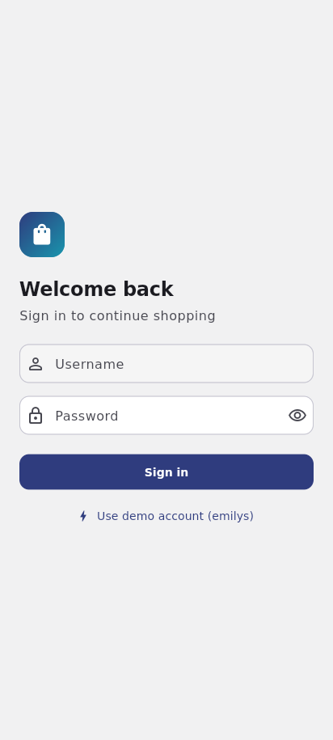 | 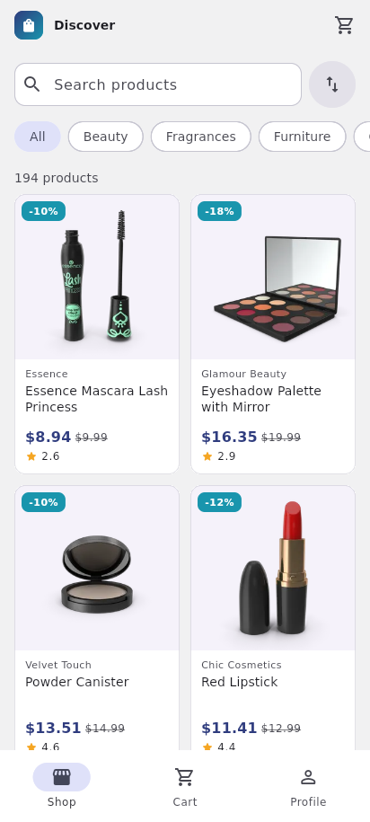 | 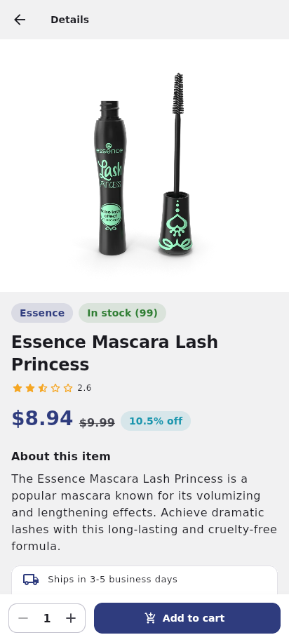 | 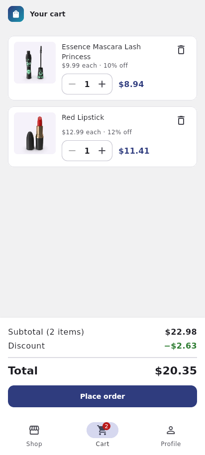 |

| Order placed | Profile | Dark mode + search | Server error (500) | Not found (404) |
|---|---|---|---|---|
| 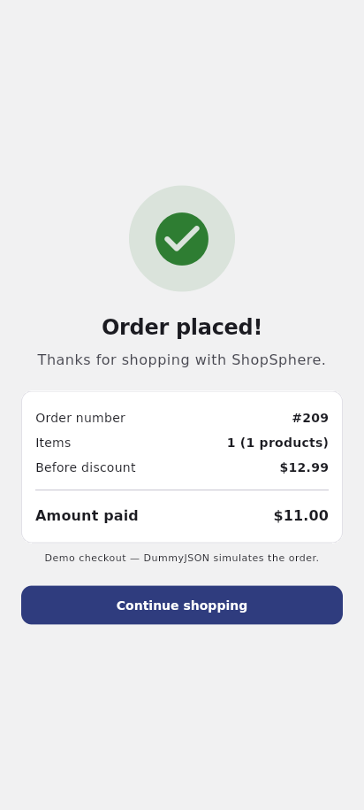 | 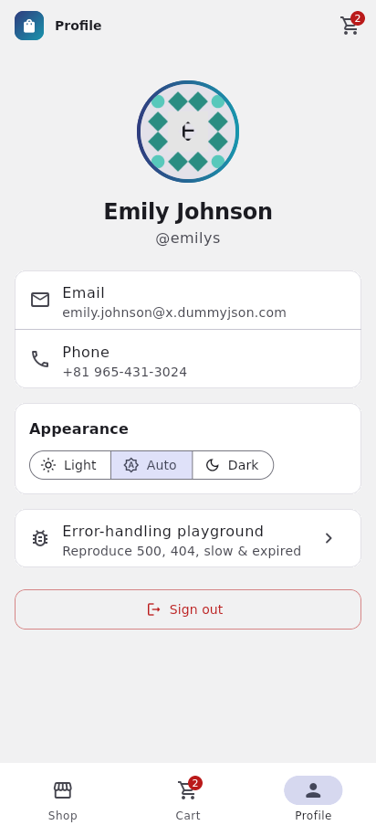 | 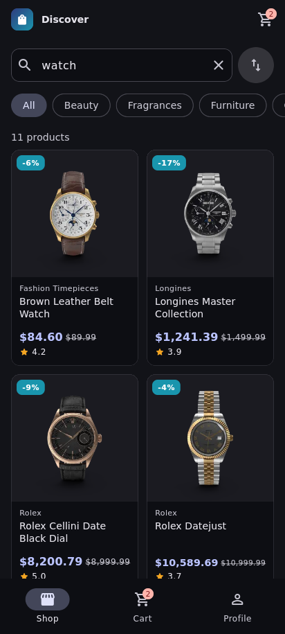 | 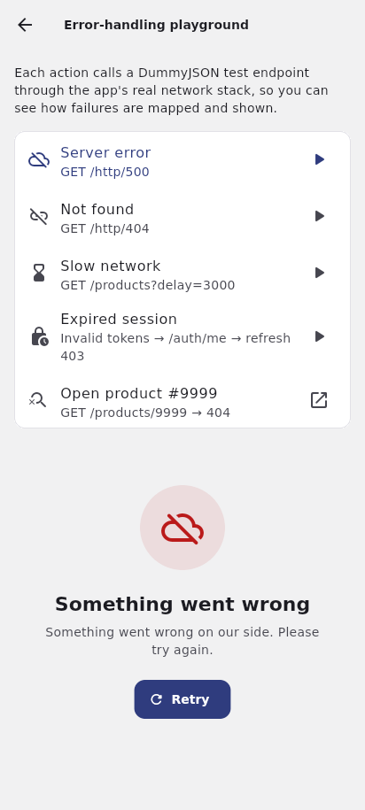 | 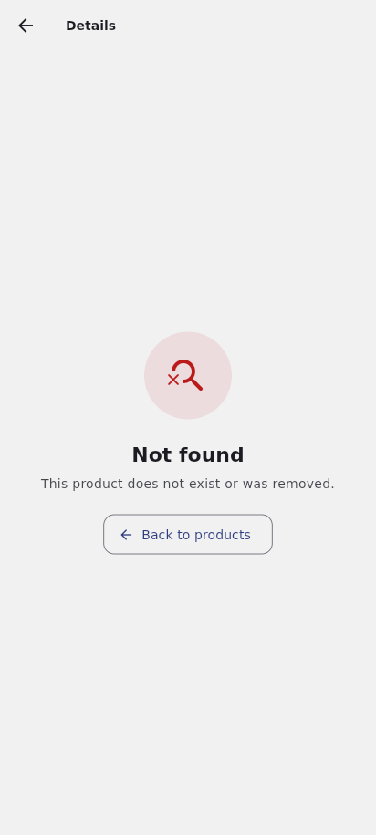 |

**Tablet**

| Landscape — master–detail | Landscape — cart | Portrait — rail + 3 columns |
|---|---|---|
| 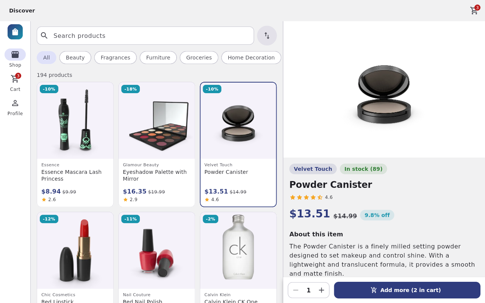 | 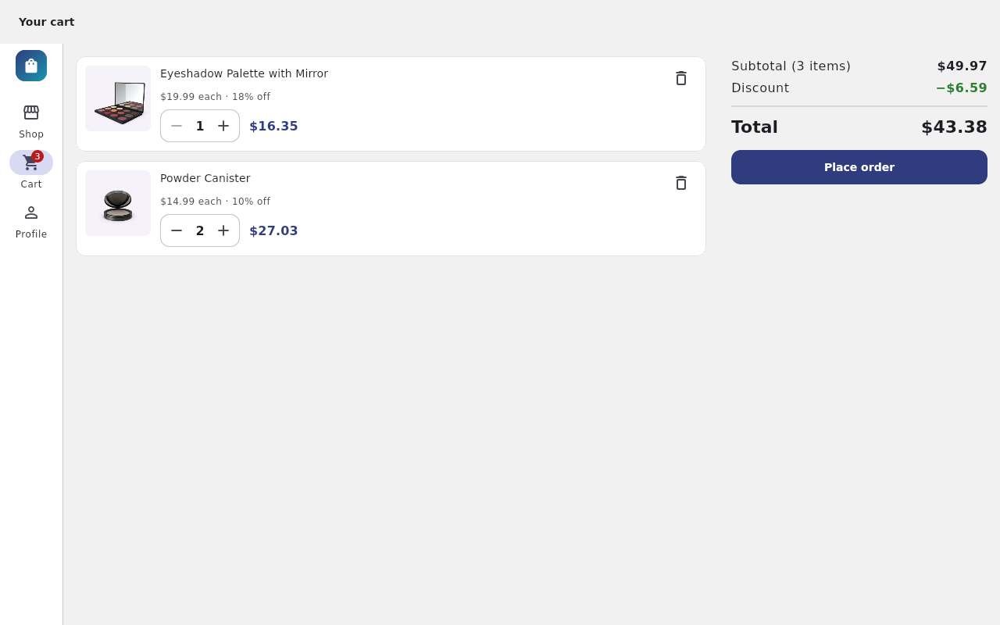 | 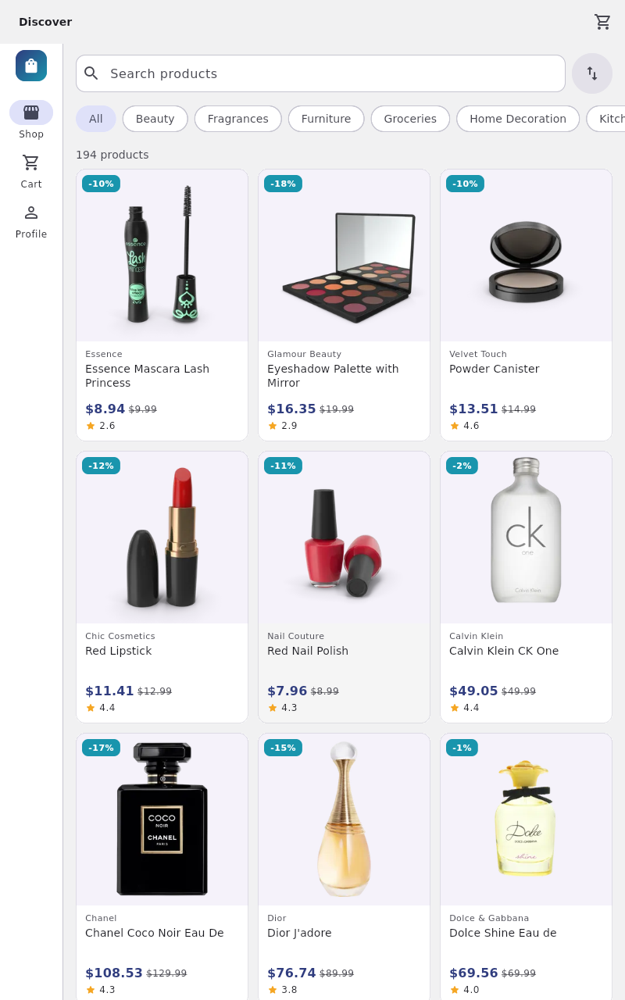 |

---

## 2. Features

### Mandatory

- [x] **Splash** checks the stored session and routes to Home or Login
- [x] **Login** with inline validation (empty, min length), password visibility toggle, loading button
- [x] `POST /auth/login`; access + refresh tokens stored in **flutter_secure_storage** (Keystore / Keychain)
- [x] Clear message for invalid credentials (HTTP 400 → "Invalid username or password")
- [x] **Product grid** with thumbnail, title, brand/category, price, discount badge, rating, out-of-stock overlay
- [x] **Infinite scroll** (`limit=20` & `skip`), footer loader, stops at the end ("You have seen all 194 products")
- [x] **Pull-to-refresh**
- [x] **Category chips** loaded from `/products/categories`
- [x] **Search** with a 400 ms debounce via `/products/search`
- [x] **Sort**: price ↑ / price ↓ / rating / title (works for all products, a category, or a search)
- [x] **Shimmer skeletons** on first load and a dedicated **no-results** state
- [x] **Details**: image carousel + page indicator, title, brand (null-safe), price & discount, rating, stock status, description, reviews
- [x] **Add to cart** with quantity selector, capped at stock and disabled when out of stock
- [x] **Non-existent product** (`/products/9999` → 404) shows "Product not found" with a way back
- [x] **Cart**: add, remove (button or swipe, with Undo), change quantity; subtotal, discount and grand total
- [x] **Cart persisted** locally with Hive — survives app restart
- [x] **Live cart badge** on the navigation bar / rail and app bar
- [x] **Place order** → `POST /carts/add` → success screen; cart cleared on success
- [x] **Profile** from `GET /auth/me`: avatar, name, email, phone
- [x] **Logout** (with confirmation) clears tokens, cart and session, returns to Login
- [x] **401 / 403 handling**: forced sign-out with a "session expired" message

### Bonus

- [x] **Automatic token refresh**: auth interceptor catches 401 → `POST /auth/refresh` → retries the original request
- [x] **Hero animation** from list thumbnail to details image
- [x] **Light / dark / system theme** toggle, persisted
- [x] **Offline mode**: last fetched catalogue page + categories cached; "You are offline" banner; auto-retry when back online
- [x] **Widget tests** (layouts at 4 screen sizes × 1.0/1.3 text scale, login, cart, profile, shell)
- [x] **CI** with GitHub Actions: format check, `flutter analyze`, `flutter test --coverage`, release APK build
- [x] **Error-handling playground** (Profile → *Error-handling playground*) that reproduces `/http/500`, `/http/404`, `?delay=3000`, an expired session and `/products/9999` through the real network stack — handy for the demo video

### Not done

- [ ] Wishlist / favourites
- [ ] Localization (English + Hindi)
- [ ] Golden tests

---

## 3. Tech stack

| | Version |
|---|---|
| Flutter | **3.47.7** (stable) |
| Dart | **3.13.5** |
| Android | minSdk 24 (supports the required Android 8.0 / API 26+), compile/target from Flutter defaults |

| Package | Why |
|---|---|
| `flutter_bloc` | Predictable, testable state with explicit event → state transitions |
| `equatable` | Value equality for entities, events and states (needed for `bloc_test`) |
| `dio` | Interceptors (auth/refresh, logging), timeouts and typed errors in one client |
| `get_it` | Simple service locator for dependency injection; widgets never construct repositories |
| `flutter_secure_storage` | Tokens in the Android Keystore / iOS Keychain, not plain prefs |
| `hive_ce` / `hive_ce_flutter` | Fast local key-value store for the cart and offline cache (maintained fork of Hive, no codegen needed) |
| `cached_network_image` | Disk-cached images with placeholders / error widgets |
| `shimmer` | Skeleton loading placeholders |
| `connectivity_plus` | Drives the offline banner and auto-retry |
| `shared_preferences` | Persists the theme choice |
| `intl` | Currency and date formatting |
| `bloc_test`, `mocktail`, `fake_async` | State-sequence tests, mocks without codegen, deterministic timers |
| `flutter_launcher_icons` | Generates the app icon |

Models are hand-written (`fromJson`/`toJson`) rather than generated, so there is **no code-generation step** and the project runs straight after `flutter pub get`.

---

## 4. Architecture

Feature-first, each feature split into **presentation → domain ← data** (dependency inversion: the domain defines interfaces, the data layer implements them).

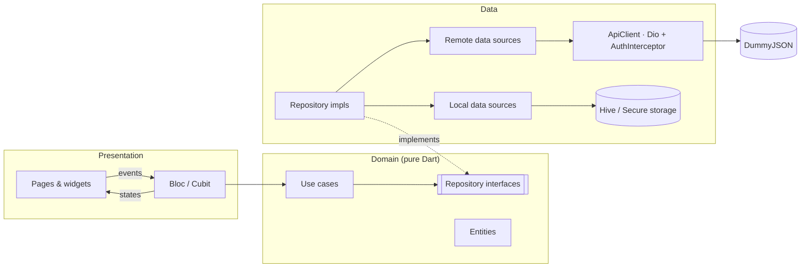

- **Domain** imports no Flutter, Dio or Hive — only `equatable`.
- **Data** owns DTOs (`ProductModel extends Product`), data sources and repository implementations.
- **Presentation** owns blocs, pages and widgets. Blocs depend on use cases only.
- **DI** (`lib/core/di/injection.dart`) wires everything; blocs are resolved with `sl<…>()`.

### Folder structure

```
lib/
  app/                      app.dart (auth gate, theme), app_shell.dart (nav bar / rail)
  core/
    di/                     get_it registrations
    error/                  exceptions.dart, failures.dart, failure_mapper.dart
    network/                api_client.dart, auth_interceptor.dart, dio_error_mapper.dart, connectivity
    session/                session_manager.dart (session-expired stream)
    storage/                token_storage.dart (secure storage)
    theme/                  app_theme.dart (M3 ThemeData, colours, spacing), theme_cubit.dart
    usecase/                UseCase base + NoParams
    utils/                  result.dart, debouncer.dart, breakpoints.dart, formatters.dart
    widgets/                ErrorView, EmptyView, ShimmerBox, AppNetworkImage, RatingStars, OfflineBanner
  features/
    auth/        data/ domain/ presentation/
    products/    data/ domain/ presentation/
    cart/        data/ domain/ presentation/
    profile/     data/ domain/ presentation/
    diagnostics/ data/ domain/ presentation/   (error-handling playground)
  main.dart
test/
  fixtures/                 JSON captured from the real API
  helpers/                  mocks, fixture reader, screen-size pump helper
  core/ features/ widgets/  mirrors lib/
```

### Data flow of one request — opening product details

1. `ProductCard` tap → `Navigator.push(ProductDetailsPage(id))` (or selects it in the master–detail pane).
2. `ProductDetailsView` creates `ProductDetailsCubit` from DI and calls `load(id)` → emits `ProductDetailsLoading` (skeleton + hero image).
3. Cubit → `GetProductDetailsUseCase(id)` → `ProductRepository.getProduct(id)`.
4. `ProductRepositoryImpl` → `ProductRemoteDataSource.getProduct(id)` → `ApiClient.get('/products/1')`.
5. Dio sends the request (timeouts, debug-only logging). A `DioException` is converted to an `AppException` (e.g. 404 → `NotFoundException`).
6. JSON → `ProductModel.fromJson`. The repository's `guard()` wraps the result as `Ok(product)` or maps the exception to a `Failure` → `Err(NotFoundFailure())`.
7. Cubit emits `ProductDetailsLoaded(product)` or `ProductDetailsFailure(failure)`; `BlocBuilder` renders the content or `ErrorView`.

---

## 5. State management

**flutter_bloc (Bloc + Cubit)**, used everywhere. Blocs for event-heavy flows (`ProductListBloc`: fetch / next page / search / filter / sort; `CartBloc`; `AuthBloc`), Cubits for simple request → result flows (login form, details, profile, categories, theme). States are explicit: `initial / loading / success / empty / failure` plus `isLoadingMore` and `loadMoreFailure` for pagination. Trade-offs: more boilerplate than Riverpod/Provider, but transitions are explicit, logic stays out of widgets, and every sequence is easy to verify with `bloc_test`. Rebuilds are kept narrow with `BlocSelector` / `context.select` (e.g. the cart badge only rebuilds on item count).

Stale responses are handled explicitly: each first-page request gets a generation number, so a slow earlier search can never overwrite a newer one.

---

## 6. Error handling

```
DioException ──mapDioException──▶ AppException ──mapExceptionToFailure──▶ Failure ──▶ UI
(network layer)                   (data layer)                            (domain)     ErrorView / inline message
```

| Situation | Exception | Failure | What the user sees |
|---|---|---|---|
| No internet | `NetworkException` | `NetworkFailure` | "You are offline" + Retry; cached catalogue if available; offline banner |
| Timeout (connect 15 s / receive 20 s) | `RequestTimeoutException` | `TimeoutFailure` | "Taking too long" + Retry |
| 400 at login | `BadRequestException` | `InvalidCredentialsFailure` | Inline "Invalid username or password" |
| 401 on a protected call | handled by `AuthInterceptor` | — | Silent refresh + retry |
| Refresh rejected (403) / no refresh token | `UnauthorizedException` | `UnauthorizedFailure` | Signed out → Login with "Your session has expired" |
| 404 | `NotFoundException` | `NotFoundFailure` | "Not found" + back button (no Retry — retrying can't help) |
| 5xx | `ServerException` | `ServerFailure` | "Something went wrong" + Retry |
| Malformed JSON | `ParseException` | `ParseFailure` | Friendly error + Retry |
| Hive / keystore error | `CacheException` | `CacheFailure` | Cart falls back to empty; cache writes are best-effort |

- Repositories return a sealed `Result<T>` (`Ok` / `Err`) — no exceptions cross into the domain or UI, and raw stack traces are never shown.
- `AuthInterceptor` is a `QueuedInterceptor`, so parallel 401s trigger a single refresh. On failure it clears tokens and emits on `SessionManager`; `AuthBloc` listens and signs the user out — the network layer never depends on UI code.
- Every network-driven screen has loading, success, empty and error UI with a retry action; pagination errors show inline under the list so loaded items stay visible.

**Try them in the app:** Profile → *Error-handling playground*, or turn on airplane mode, or log in with a wrong password.

---

## 7. Responsive layouts

| Width | Layout |
|---|---|
| **Compact** < 600 dp | 2-column grid, bottom `NavigationBar` |
| **Medium** 600–1024 dp | 3–4 column grid, `NavigationRail` |
| **Expanded** > 1024 dp | Master–detail: catalogue and details side by side |

Grid tiles size their text area with the current text scaler, so there are **no overflows at 1.3× font scale**; long prices scale down instead of truncating. Details show gallery and info side by side in landscape. Widget tests render the catalogue, details and cart at phone/tablet × portrait/landscape × 1.0/1.3 text scale and fail on any overflow.

---

## 8. Getting started

**Prerequisites:** Flutter 3.47.x stable (`flutter --version`), Android SDK, an emulator or device on Android 8.0+.

```bash
git clone https://github.com/<username>/prosessed-flutter-assignment.git
cd prosessed-flutter-assignment
flutter pub get          # no code generation step needed
flutter run              # pick an emulator / device
```

**Release APK**

```bash
flutter build apk --release
# → build/app/outputs/flutter-apk/app-release.apk
```

The release build is signed with the debug key unless an `android/key.properties` (git-ignored) is present with `storeFile`, `storePassword`, `keyAlias`, `keyPassword`.

**Regenerate the launcher icon** (only if you change `assets/icon/`): `dart run flutter_launcher_icons`

---

## 9. Testing

```bash
flutter test                 # 127 tests
flutter test --coverage      # writes coverage/lcov.info
flutter analyze              # 0 issues
dart format --set-exit-if-changed lib test
```

**127 tests, all passing — 77.2% line coverage across the whole of `lib/`.** (`test/coverage_helper_test.dart` imports every file, so untested files count as 0% instead of being silently left out.)

| Area | What is covered |
|---|---|
| JSON parsing | Product, page, category, login, order — using fixtures captured from the real API, incl. a product without `brand` |
| Network | Dio error → exception mapping; **AuthInterceptor**: Bearer header, 401 → refresh → retry, refresh 403 → tokens cleared + session expired |
| Repositories | Success, server failure and network failure paths for products, auth, cart, profile; offline cache fallback; cache errors never break requests |
| Data sources | Endpoints, query/sort params, request bodies; Hive round-trips for cart and offline cache |
| Use cases | Login trimming, search normalisation, cart totals (rounding), empty-cart checkout |
| Blocs / Cubits | `bloc_test` sequences for products (pagination, load-more failure, search, filter, stale responses), cart (merge, stock cap, checkout), auth (splash routing, session expiry), login, details |
| Widgets | Login validation, ErrorView, catalogue/cart/details at 4 screen sizes × 2 text scales, navigation bar vs rail, offline banner, logout confirmation |

---

## 10. Test credentials

| Username | Password |
|---|---|
| `emilys` | `emilyspass` |

Any user from `GET https://dummyjson.com/users` also works with their listed username and password.

---

## 11. Assumptions & trade-offs

- **Search and category can't be combined** — DummyJSON has no endpoint for both. Picking a category clears the search; typing a search searches all products. Sort applies to either.
- **Splash checks for a stored token** rather than calling `/auth/me`, so the app opens offline. An expired token is caught on the first protected call (profile / refresh flow).
- **Order total**: DummyJSON rounds its own `discountedTotal` per product, so the success screen shows the total the user saw in the cart, plus the server's order number and quantities.
- **Cart is cleared on logout** (it's session data on a shared device), but kept across app restarts.
- **Quantities are capped at stock**; there is no server-side stock reservation (DummyJSON doesn't persist anything).
- **Offline cache** covers the first catalogue page and categories — enough to browse, without building a full sync layer.
- **Hand-written models** instead of `freezed` / `json_serializable`: fewer moving parts and no build step, at the cost of some boilerplate.

**With more time:** wishlist, English + Hindi localization, golden tests, integration tests with `patrol`, `go_router` deep links (e.g. `/product/:id`), and caching product details for offline viewing.

---

## 12. Use of AI tools

_Describe honestly how you used AI assistants (the brief requires this), e.g. which parts were generated or suggested, what you reviewed, changed and verified yourself._

---

## 13. Author

**<Your full name>** · <email> · [LinkedIn](https://linkedin.com/in/<handle>) · [Portfolio](https://<site>)
